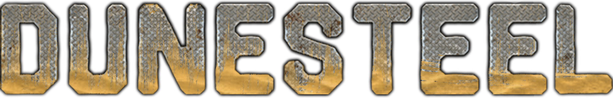
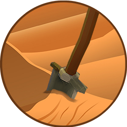
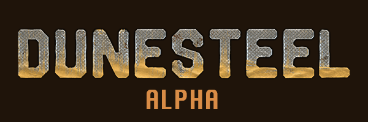

**An old-fashioned engineer, a cheap-ass space airline, and a desert planet that shouldn't have life on it.**

[⭐ Star this repo](https://github.com/KirillEraser/dunesteel) if you like dry engineering humor and anti-corporate sci-fi.

---

## About

**Dunesteel** is a first-person survival/exploration game built in **Unreal Engine 4**. You play a PEE (Program of Exoplanetary Exploration) engineer dumped onto **Nusquam** — a flat, waterless desert planet that is somehow inhabited — by budget carrier *Aerofordable*, whose landing pods are designed to self-destruct on arrival as "standard procedure." No manuals included.

Your jobs, in order of how much the company cares:
1. Collect samples of Dunesteel, the planet's signature metal.
2. Figure out how the hell water circulates on a planet that has none on the surface.
3. Don't die while doing 1 and 2 with a Magnetic Force Field Soil Sampling Device being used as a pickaxe.

## Premise

- **Setting:** Nusquam — desert, no peaks over 20m, no surface water, yet biologically active.
- **Tone:** Dry engineering humor, anti-corporate jabs, lonely exploration.
- **Arc:** Crash → scavenge organics → jury-rig gear from sketchy blueprints → fix comms → SOS → link up with a colonisation ship full of engineers who also hate Aerofordable → reconnect to PEE.

## Status: Alpha — barely playable

Two-person project. Expect placeholder art, half-wired systems, and bugs funnier than the jokes. Not accepting bug reports yet.

### What works
- Save/load
- New movement system
- Inventory system
- Tool system + starter tools (soil sampler, etc.)
- Tablet UI with Main Menu, Settings, Inventory, Messages, Save Game tabs
- Pause menu + GUI pass
- Resource placement randomiser
- Invisible character head (first-person fix)
- Default gun yeeted

### In progress
- Beacons (holographic waypoint markers — actor + inventory hookup done, custom text pending)
- Resource descriptions (look-at name display)

### Coming up
- Settings menu wiring
- Dialogue system (currently stalled)
- Tablet battery charge mechanic
- Debug console
- "Maybe" option on quit screen (priority: critical, obviously)

## Built with
- Unreal Engine 4
- Blueprints

## Team

**Kirill Zavgorodnii** ([@KirillEraser](https://github.com/KirillEraser)) — art direction, blueprint design, level design, story & setting

**Ilya Prokopov** — backend dev: co-coded the inventory and movement systems, tool use/hold mechanics, settings menu, and more

## License
All rights reserved.

Developed with Unreal Engine 4
